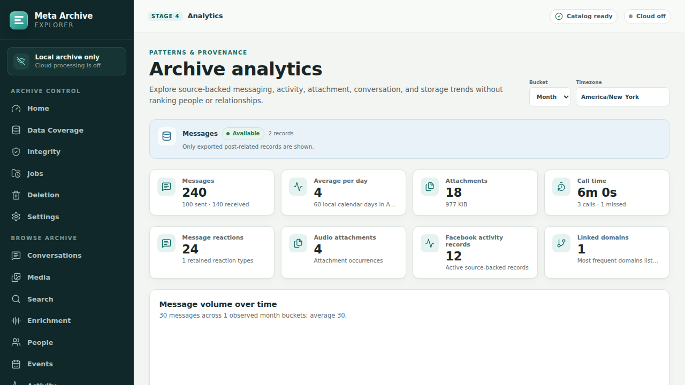

# Meta Archive Explorer

Meta Archive Explorer is a local-first application for consolidating, validating, searching, and
browsing Facebook account exports. It turns one or more export chunks into a provenance-preserving
catalog, a content-addressed blob store, and a responsive localhost-only interface.



_The screenshot above is generated from synthetic test fixtures. No real export data is committed._

## Highlights

- Deterministic multi-chunk consolidation with hashing, deduplication, collision handling, and
  reconstruction provenance.
- Conversation, media, activity, people, event, support, timeline, and analytics views that keep
  incomplete source coverage visible.
- Keyword, exact, semantic, and hybrid search with source jumps, local model provenance, and
  optional cited cloud RAG.
- Local audio transcription, attachment-text extraction, language signals, topic clusters, and
  deliberately non-authoritative conflict-review aids.
- Revision-bound starring, reversible quarantine, restore, and explicit hard-purge workflows.
- A privacy boundary built around loopback-only serving, one-time authentication, CSRF protection,
  path confinement, owner-only runtime artifacts, and cloud processing that is off by default.

## Architecture

```text
Meta export chunks
        |
        v
consolidation + verification --> content-addressed blobs + provenance manifests
        |
        v
SQLite catalog + FTS5 + local vector index
        |
        v
FastAPI / Typer backend --> React / TypeScript browser UI on 127.0.0.1
```

| Layer | Main components |
|---|---|
| Backend | Python 3.12, FastAPI, Typer, SQLAlchemy, Alembic |
| Frontend | React 19, TypeScript, Vite, TanStack Router/Query/Table, ECharts |
| Search and enrichment | SQLite FTS5, LanceDB, FastEmbed, faster-whisper, Transformers |
| Verification | Pytest, Hypothesis, Vitest, Testing Library, Playwright, Axe |

The source export is never committed. Runtime catalogs, blobs, generated library views, models,
screenshots from real-data review, and deletion quarantine are excluded from Git. The repository's
tracked fixtures and visual baselines are synthetic. See [SECURITY.md](SECURITY.md) for the data
handling and vulnerability-reporting policy.

Stages 1-5 are implemented. Image/video semantic classification, OCR, zero-shot media tags, and a
Memes dashboard remain intentionally outside the implemented scope. The detailed data contracts,
invariants, and delivery rationale live in [PLAN.md](PLAN.md).

## Repository map

- `src/meta_archive/` contains the CLI, API, models, importers, search, verification, and deletion
  services.
- `web/` contains the React application plus unit, accessibility, and browser tests.
- `tests/fixtures/` contains synthetic export fragments that exercise observed Meta schema shapes.
- `alembic/` contains the catalog migration history.
- `scripts/` contains bounded real-export acceptance and verification tooling.
- [CONTRIBUTING.md](CONTRIBUTING.md) documents the development and validation workflow.

## Starred items

Use the star control beside a conversation, individual message, attachment, unique media file,
activity record, event, or Messenger contact to add it to the **Starred** page in the left
navigation. That page combines every supported item type, filters by category, orders by when an
item was starred, previews retained media, and links back to the exact message, conversation,
activity record, event, or contact whenever a source jump is available.

Stars are private catalog metadata and never modify the exported Facebook files. Reversible
quarantine temporarily hides affected stars and restore makes the same star identities visible
again. A confirmed hard purge removes stars whose targets are permanently erased. Reimport and
conversation-correction workflows preserve stars when the same stable target remains available.

## Quick start

Run the development setup below once, then choose the workflow that matches the archive state. For
an archive that has already been consolidated and ingested, point `archive_root` at that prepared
private export. `status`, `warm-analytics`, and a regular `serve` automatically apply pending Alembic
migrations; no manual `alembic upgrade` command is required. Build the browser bundle, warm the
revision-bound analytics responses, and launch the localhost-only application:

```bash
archive_root="/absolute/path/to/meta-backup-export"
uv run meta-archive doctor --archive-root "$archive_root"
pnpm build
uv run meta-archive status --archive-root "$archive_root"
uv run meta-archive warm-analytics --archive-root "$archive_root"
uv run meta-archive serve --archive-root "$archive_root"
```

`serve` prints a one-time URL such as `http://127.0.0.1:8765/auth?token=...`. Open that exact URL
in a browser; it exchanges the short-lived startup token for an HttpOnly local session. The token
expires when the server process stops, and the application refuses non-loopback binds.

For a new raw Facebook export, consolidate and ingest it before using the prepared-archive quick
start. `consolidate --dry-run` hashes and previews every source copy without building the blob store;
review and resolve any reported normalized-path conflicts before continuing. The apply command
never retires the original source chunks. Supply the archive owner's exact display name on the first
message import, then build the human-readable filesystem library:

```bash
archive_root="/absolute/path/to/meta-backup-export"
uv run meta-archive doctor --archive-root "$archive_root"
uv run meta-archive consolidate --dry-run --archive-root "$archive_root"
uv run meta-archive consolidate --apply --archive-root "$archive_root"
uv run meta-archive ingest --archive-root "$archive_root" \
  --owner-name "<exact Facebook display name>"
uv run meta-archive build-library --archive-root "$archive_root"
pnpm build
uv run meta-archive warm-analytics --archive-root "$archive_root"
uv run meta-archive serve --archive-root "$archive_root"
```

This initial workflow makes the archive browsable without waiting for optional long-running media,
transcription, NLP, topic, or semantic-index workers. Run those resumable workers in the order below
when their corresponding derived views and search modes are wanted. Source retirement is a separate,
explicit operation and is never part of first import.

The long-running derived-data order is: attachment extraction and audio transcription first,
then `annotate-text`, then `index-semantic --rebuild-windows`, then topic clusters, and finally
`warm-analytics`. Semantic indexing must be rerun after new transcript or extracted text rows so
the derived text is not omitted from its window snapshot. Each worker is resumable and its exact
status is visible on the Jobs and Enrichment pages; image/video classification is intentionally not
part of this sequence and remains gated on separate approval.

The owner display name is stored only in the private SQLite catalog; source code and committed
fixtures use the neutral `Archive Owner` label. To adopt or correct it independently of the initial
workflow, run:

```bash
uv run meta-archive ingest --archive-root "$archive_root" \
  --owner-name "<exact Facebook display name>"
```

When an older catalog already has correct owner flags but lacks the setting, this command adopts
the setting and reuses unchanged source imports. If retained flags disagree, it deliberately
reimports message sources so sent/received classifications cannot remain stale.

### Privacy upgrade for an existing prepared archive

An existing catalog created before the support-message privacy migration needs one targeted
post-migration library repair. First run an ordinary catalog command so Alembic moves narrowly
matched IP, payment, billing, card, bank-account, and credential metadata out of public support
message metadata and into the gated sensitive column. Then repair only the legacy support
transcript NDJSON files already present in the filesystem library:

```bash
archive_root="/absolute/path/to/meta-backup-export"
uv run meta-archive status --archive-root "$archive_root"
uv run meta-archive scrub-support-library --archive-root "$archive_root"
```

The scrub is idempotent, runs under the filesystem-library publication lock, validates all affected
files before publishing any replacement, and prints aggregate counts only. It does not rebuild or
rewrite ordinary conversation transcripts. A later full `build-library` also emits the corrected
redacted representation, but is not required merely to apply this privacy fix. Complete this
upgrade before starting either acceptance-read-only workflow; acceptance mode never migrates or
repairs an archive.

The original source roots in the checked-out archive were retired only after deep parity and
reconstruction gates passed. Their immutable relocation manifests, retirement receipt, and blob
store remain in the archive. To prove reconstruction without changing the archive, use an empty
target directory outside the archive root:

```bash
uv run meta-archive reconstruct-source /path/to/empty-reconstruction-target \
  --archive-root "$archive_root"
```

For a future export, `retire-source` is dry-run-only unless `--apply` is supplied and every exact
chunk must be named with a repeated `--chunk <root-name>` option. Do not point the reconstruction
or retirement commands at the archive root itself.

If two chunks contain the same normalized relative path with different bytes, the non-mutating
`consolidate --dry-run` reports the conflict and exits without creating holding files.
`consolidate --apply` copies every physical variant into
`conflicts/normalized-path/<group-id>/<revision-id>/copies/` and writes a read-only provenance
manifest beside them. Group and revision IDs are deterministic; an existing held copy is verified
and reused, never overwritten. The blob-store apply phase remains blocked until the underlying
source conflict is reviewed and resolved. The holding area is private archive data and stays
outside Git with the rest of the export.

## Development setup

```bash
uv sync --all-groups
pnpm runtime set node 24.18.0 -g
pnpm install
uv run meta-archive doctor
```

Use `uv run meta-archive --help` for the archive workflow. Physical consolidation is always
preceded by a dry run and reconciliation; no command requires `sudo`.

Run the automated gates from the repository root with:

```bash
pnpm runtime set node 24.18.0 -g
uv lock --check
uv sync --frozen --all-groups
uv run alembic heads
uv run ruff check .
uv run ruff format --check .
uv run mypy src scripts
uv run python -m compileall -q src tests scripts alembic web/tests/helpers
uv build
uv run pytest -q
pnpm install --frozen-lockfile
pnpm --dir web run lint
pnpm --dir web run test
pnpm --dir web run test:real-ui-unit
pnpm --dir web run build
pnpm --dir web run test:e2e
pnpm --dir web run test:e2e:destructive
```

The destructive browser suite never accepts an archive path. Its helper creates a fresh synthetic
archive inside an owner-private temporary directory, runs the real authenticated UI and API through
preview, quarantine, disappearance, and restore, and then asserts that the entire temporary tree
was removed. It must not be adapted to point at a real export.

## Real-export acceptance protocol

Real-export acceptance runs only against an ignored, owner-private archive. Its reports contain
aggregate evidence, while screenshots and traces remain local and must never be committed.

<details>
<summary>Detailed local acceptance workflow and evidence contract</summary>

<br>

Run final acceptance only after all derived-data workers have finished, the semantic index is
active, analytics are warm, and the current stable catalog has a passing deep-verification
receipt. The catalog reconciler is
read-only: it opens SQLite with `mode=ro` and `PRAGMA query_only=ON`. The browser runner requires a
dedicated acceptance-read-only server, blocks every request method except GET/HEAD, and runs with
analytics cache reads and writes disabled. Both tools publish aggregate JSON without message text,
names, titles, filenames, query text, or raw database identifiers. Screenshots and traces still
contain private archive content, so they
remain under ignored `.private-review/` directories with owner-only permissions.

Exact export expectations are private data. Final verification and real-export acceptance load
them from `$archive_root/manifests/audited-baseline.json`, never from committed source. The file
must be a regular, non-symlink file no larger than 64 KiB with mode `0600` (or stricter
owner-only permissions). It uses this exact
schema; every metric is a non-negative 64-bit integer, and
`archive_identity_sha256` is the lowercase SHA-256 of the archive directory's basename encoded as
UTF-8:

```json
{
  "schema_version": 1,
  "archive_identity_sha256": "<64 lowercase hexadecimal characters>",
  "metrics": {
    "chunks": 0,
    "directories": 0,
    "files": 0,
    "bytes": 0,
    "json_files": 0,
    "transcript_containers": 0,
    "ordinary_segments": 0,
    "ordinary_messages": 0,
    "canonical_participants": 0,
    "message_reactions": 0,
    "message_attachments": 0,
    "support_segments": 0,
    "support_messages": 0,
    "activity_records": 0,
    "exact_duplicate_messages": 0,
    "normalized_path_collisions": 0,
    "unique_blobs": 0,
    "unique_blob_bytes": 0,
    "duplicate_file_occurrences": 0,
    "duplicate_bytes": 0,
    "unresolved_local_uri_occurrences": 0,
    "unlinked_media_paths": 0,
    "leading_message_gap_segments": 0,
    "internal_message_gap_segments": 0,
    "activity_reactions_raw": 0,
    "activity_reactions_logical": 0,
    "largest_conversation_messages": 0
  }
}
```

The zeroes above document types only; replace every value with the independently audited private
expectation. Ordinary fixture verification may omit the manifest, any present malformed manifest
fails verification, and final real-export acceptance fails closed unless it is valid and complete.
Keep this file inside the ignored archive root and never stage it.

The acceptance server refuses to start while a SQLite WAL, SHM, or rollback-journal sidecar is
present. Stop every catalog writer and let the final worker/verification process close cleanly
before starting it; the server never checkpoints, migrates, repairs permissions, recovers purge
state, or otherwise changes the archive it is measuring.

Routine browser acceptance reuses the current passing deep-verification receipt. The production
spot check additionally revalidates that receipt's bound manifest and library-marker artifacts;
neither requires another full archive walk.

After updating application code, first run an ordinary catalog command such as `status` to apply any
pending migration, then let it exit cleanly. Acceptance-read-only mode deliberately refuses an
outdated catalog and never applies migrations itself. If a catalog-only migration makes an
otherwise current deep receipt stale, rebind it without rehashing source bytes:

```bash
uv run python scripts/rebind_deep_verification_receipt.py \
  --archive-root "$archive_root"
```

The rebind command carries forward only a prior passing `deep.source_bytes` check. It requires the
owner-only prior receipt, every recorded source-manifest and library-marker identity to remain
exact, and a fresh passing non-deep catalog verification. It preserves the exact prior report as a
digest-named owner-only audit copy and fails closed on any mismatch. If it refuses the receipt, or
the receipt or bound artifacts are missing or changed, run explicit deep verification once:

```bash
archive_root="/absolute/path/to/meta-backup-export"
uv run meta-archive verify --deep --archive-root "$archive_root"
```

That fallback rehashes every original file or retained blob and can therefore take substantial
time.

First, create a fresh owner-only browser-evidence directory and run the acceptance-read-only server
and browser as one transient-service process tree. The preflight requires 7.75 GiB of currently
available host memory and a free default port. The service has a 5 GiB soft memory threshold, a
hard 5.75 GiB (5888 MiB) memory ceiling, no swap, at most 512 tasks, and a 45-minute wall-time limit. It kills the
whole cgroup after an OOM, timeout, browser failure, or shell exit, while the shell trap gives the
server a normal shutdown opportunity first:

```bash
set -euo pipefail
archive_root="/absolute/path/to/meta-backup-export"
ui_run_id="$(date -u +%Y%m%dT%H%M%SZ)"
ui_root="$(pwd)/.private-review/final-real-ui-$ui_run_id"
uv_bin="$(command -v uv)"
pnpm_bin="$(command -v pnpm)"
available_kib="$(awk '/^MemAvailable:/ { print $2 }' /proc/meminfo)"

test "$available_kib" -ge 8126464 || {
  echo "At least 7.75 GiB of available host memory is required for the bounded UI pass." >&2
  exit 1
}
if ss -ltnH '( sport = :8765 )' | grep -q .; then
  echo "Port 8765 is already in use; stop the existing server first." >&2
  exit 1
fi
umask 077
test ! -L "$(pwd)/.private-review"
test ! -e "$ui_root" && test ! -L "$ui_root"
install -d -m 700 "$(pwd)/.private-review" "$ui_root"

set +e
systemd-run --user --wait --collect \
  --unit="meta-archive-ui-$ui_run_id" \
  --description="Meta Archive bounded UI acceptance" \
  --same-dir \
  --service-type=exec \
  --setenv=PATH="$PATH" \
  --property=ExitType=cgroup \
  --property=KillMode=control-group \
  --property=SendSIGKILL=yes \
  --property=TimeoutStopSec=30s \
  --property=OOMPolicy=kill \
  --property=MemoryAccounting=yes \
  --property=MemoryHigh=5G \
  --property=MemoryMax=5888M \
  --property=MemorySwapMax=0 \
  --property=TasksAccounting=yes \
  --property=TasksMax=512 \
  --property=RuntimeMaxSec=45min \
  --property=StandardOutput=null \
  --property=StandardError=null \
  /usr/bin/env bash -c '
    set -euo pipefail
    archive_root=$1
    ui_root=$2
    uv_bin=$3
    pnpm_bin=$4
    server_pid=""
    cleanup() {
      local return_code=$?
      trap - EXIT INT TERM
      if [[ -n "$server_pid" ]] && kill -0 "$server_pid" 2>/dev/null; then
        kill -INT "$server_pid" 2>/dev/null || true
        wait "$server_pid" 2>/dev/null || true
      fi
      exit "$return_code"
    }
    trap cleanup EXIT
    trap "exit 130" INT
    trap "exit 143" TERM

    "$uv_bin" run meta-archive serve --acceptance-read-only \
      --archive-root "$archive_root" \
      --startup-token-file "$ui_root/startup-token" &
    server_pid=$!
    for ((attempt = 0; attempt < 240; attempt++)); do
      if [[ -s "$ui_root/startup-token" ]] && \
        ss -ltnH "( sport = :8765 )" | grep -q .; then
        break
      fi
      kill -0 "$server_pid"
      sleep 0.25
    done
    [[ -s "$ui_root/startup-token" ]]
    ss -ltnH "( sport = :8765 )" | grep -q .

    sh scripts/run-private-ui-review.sh \
      "$pnpm_bin" --dir web run test:real-ui -- \
        --base-url http://127.0.0.1:8765 \
        --token-file "$ui_root/startup-token" \
        --output "$ui_root/report.json"
  ' meta-archive-ui "$archive_root" "$ui_root" "$uv_bin" "$pnpm_bin"
ui_service_status=$?
set -e

ui_postflight_status=0
if ((ui_service_status != 0)); then
  echo "The bounded UI service failed with status $ui_service_status." >&2
  ui_postflight_status=1
fi
if [[ ! -f "$ui_root/report.json" ]]; then
  echo "The bounded UI pass did not publish its final report." >&2
  ui_postflight_status=1
fi
if [[ -e "$ui_root/startup-token" ]]; then
  echo "The bounded UI pass did not remove its startup-token inode." >&2
  ui_postflight_status=1
fi
if ss -ltnH '( sport = :8765 )' | grep -q .; then
  echo "Port 8765 is still in use after the UI pass." >&2
  ui_postflight_status=1
fi
test "$ui_postflight_status" -eq 0
```

The server atomically creates the startup-token file with mode `0600`, never prints the
token-bearing URL, and removes only that exact inode when it stops. The runner consumes that token,
blocks non-loopback network requests, and records schema-5 evidence for exactly 36 page runs, 42
required interaction stories (21 at each viewport), 36 screenshots, and two traces. Each page must
pass axe's WCAG 2.0/2.1/2.2 A/AA rules with no incomplete results, first-tab-stop skip-link,
reduced-motion, root-overflow, console/request-error, initial-content, and route-identity checks;
the largest reader must also stay within its loaded and rendered DOM bounds. Any nonzero service
exit, OOM, timeout, incomplete viewport, missing artifact, or missing final report invalidates the
entire pass. Never reuse partial evidence; rerun into a new directory.

The browser consumes its startup token. Final catalog/API reconciliation is a separate, one-command
production archive spot check. `scripts/run_production_acceptance.py` starts the fresh
acceptance-read-only server, receives its startup token through a new owner-only file, runs the
client, stops the complete server tree, removes that exact token inode, and writes an owner-only
stack receipt. The supervisor's monitored leader shim starts this runner as its single workload,
so the runner, server, and client remain in one measured process group. Run that group in a user
systemd transient service so a second aggregate cgroup boundary survives a supervisor or child
failure.

Use a new owner-only run directory every time. The two child destinations below must not already
exist. The service applies a soft memory throttle at 3 GiB, a hard 4 GiB memory ceiling, disables
swap for the unit, limits concurrent tasks to 512, and kills the whole cgroup on timeout, OOM, or
service exit. The inner supervisor samples the same process tree every 0.5 seconds and requests
whole-group termination when a sample exceeds 3.5 GiB RSS, 80 GiB physical reads, 256 GiB logical
reads, or 2,048 observed process identities, or when elapsed time exceeds 45 minutes. This WSL
user slice does not currently delegate the cgroup v2 `io` controller, so the runnable command uses
the explicit `proc-tree-inclusive` source:

```bash
set -euo pipefail
archive_root="/absolute/path/to/meta-backup-export"
ui_root="/absolute/path/to/the-passing-final-real-ui-run"
browser_report="$ui_root/report.json"
run_id="$(date -u +%Y%m%dT%H%M%SZ)"
run_root="$(pwd)/.private-review/production-spot-check-$run_id"
uv_bin="$(command -v uv)"
umask 077
test ! -e "$run_root" && test ! -L "$run_root"
install -d -m 700 "$(pwd)/.private-review" "$run_root"
test ! -e "$run_root/supervisor" && test ! -e "$run_root/stack"

systemd-run --user --wait --collect \
  --unit="meta-archive-acceptance-$run_id" \
  --description="Meta Archive production acceptance" \
  --same-dir \
  --service-type=exec \
  --setenv=PATH="$PATH" \
  --property=ExitType=cgroup \
  --property=KillMode=control-group \
  --property=SendSIGKILL=yes \
  --property=TimeoutStopSec=30s \
  --property=OOMPolicy=kill \
  --property=MemoryAccounting=yes \
  --property=MemoryHigh=3G \
  --property=MemoryMax=4G \
  --property=MemorySwapMax=0 \
  --property=TasksAccounting=yes \
  --property=TasksMax=512 \
  --property=RuntimeMaxSec=45min \
  --property=StandardOutput=null \
  --property=StandardError=null \
  "$uv_bin" run python scripts/supervise_acceptance.py \
    --output-dir "$run_root/supervisor" \
    --physical-read-source proc-tree-inclusive \
    --wall-seconds 2700 \
    --max-rss-bytes 3758096384 \
    --max-read-bytes 85899345920 \
    --max-rchar-bytes 274877906944 \
    --sample-seconds 0.5 \
    --term-grace-seconds 8 \
    --max-process-identities 2048 \
    -- \
    "$uv_bin" run python scripts/run_production_acceptance.py \
      --archive-root "$archive_root" \
      --browser-report "$browser_report" \
      --work-dir "$run_root/stack" \
      --reconciliation-seed 20260722
```

`proc-tree-inclusive` reads each live member's `/proc/<pid>/io`, sums the instantaneous process
group counters, and retains the monotonic peak. Linux folds a waited-for child's counters into its
parent, so peak-of-sum counts those bytes once before and after the fold; per-identity cumulative
deltas would count them twice. The same rule applies to logical `rchar`. The supervisor places the
requested command beneath a monitored leader shim. That shim waits for the workload, remains alive
with the folded counters until the supervisor acknowledges one final sample, and only then exits.
This closes the last sampling interval even when the requested command performs all of its I/O and
exits immediately. Zombie and exited entries contribute zero during an intermediate reap gap, while
the retained peak preserves the prior observation. The supervisor fails closed if the live shim or
group cannot be measured, the acknowledgement protocol fails, a counter decreases, a PID is reused
with a different start identity, or the identity ceiling is crossed. All acceptance work must remain
in the inherited process group. The shim gives only its workload a reserved shim-PID claim. The
production stack runner accepts that claim only after validating the complete, bounded, live,
same-group ancestor chain through wrappers such as `uv`; it ignores exactly itself and that chain
during final cleanup, strips the claim from server/client children, and fails closed on any invalid,
stale, cyclic, or unrelated process identity.

Where the supervisor's own unified cgroup exposes an `io.stat` file, select
`--physical-read-source cgroup-v2` as the preferred physical-read source. It captures a baseline
before starting the child, then bounds the sum of every device's `rbytes` delta. Membership parsing,
cgroup traversal, unique device keys, mandatory nonnegative `rbytes` counters, counter monotonicity,
and file size are validated fail closed. Every sample also confirms that the live leader shim still
shares the supervisor's exact cgroup. Descendants inherit that placement; this mode assumes the unit
is not delegated to the workload, so it cannot migrate them elsewhere. Logical `rchar`, RSS, process
identities, and cleanup still use `/proc`. Do not select this mode merely because the host mount is
cgroup v2: the exact transient unit must have its own readable `io.stat`; the current WSL user slice
does not, even when a user unit requests `IOAccounting=yes`.

Supervisor reports use schema 2. Consumers must read `measurement.physical_read_source`,
`limits.max_physical_read_bytes`, and `observed.physical_read_bytes`; sample journal records carry
the same source and generic byte field. `measurement.process_tree_protocol` is
`leader-shim-v1`. Schema-1 `max_tree_proc_read_bytes` and
`tree_proc_read_bytes` fields are intentionally not emitted because their name cannot honestly
represent cgroup measurements. `tree_proc_rchar_bytes` remains source-specific and unchanged.

The recommended internal profile is `production-spot-check-v2`. It verifies the exact current
catalog totals, current audited-baseline digest and schema binding, stable SQLite file identity and
data version, and the acceptance server's stable catalog, search, vector, backend, and frontend
identity. It revalidates the prior owner-only deep source/catalog receipt and rehashes its current
manifest and filesystem-library marker artifacts. Against that exact state, it deterministically
checks at most eight representative sort streams, two pages per stream, twelve sampled rows per
derived family, three search stories, bounded analytics, source jumps, and no more than 48 API
calls. The current browser report remains separately bound to the stable server identity, archive
totals, largest conversation, screenshots, and traces.

This run deliberately does not perform a full roughly 40 GB source/blob rehash, full NLP or Lance
reconstruction, full derived-product reconstruction, all-pages analytics, or all 124 sort streams.
Unsampled cursor positions and unsampled derived rows or artifacts are not checked by this run.
Some current media, event, analytics, and semantic endpoints necessarily perform work beyond the
bounded response prefix; the systemd and sampled supervisor ceilings contain that unavoidable
endpoint work.

Three owner-only files establish the result. `supervisor/report.json` records sanitized aggregate
limits, observed RSS and I/O, termination state, and cleanup without the command, environment,
paths, or child output. `stack/acceptance-report.json` records aggregate checks and must identify
`production-spot-check-v2` with a passing gate. `stack/stack-receipt.json` binds the exact acceptance
report digest to that expected profile and gate result, and records server/client cleanup. Treat the
run as passing only when the transient service exits zero, the supervisor status is `passed`, the
acceptance gate passes with zero blocking checks, and the stack receipt reports `stack_status` as
`passed`, `profile_matches` as true, `gate_passed` as true, and exact cleanup as confirmed.

Both `--reconciliation-mode risk-bounded` (`risk-bounded-v1`) and
`--reconciliation-mode exhaustive` remain explicit, costly opt-ins through
`scripts/real_export_acceptance.py`. They are not the recommended final acceptance default.

The production runner exits nonzero if a required check fails, is unavailable, or remains pending.
It accepts only a browser report produced within 24 hours by the current runner, bound to current
archive totals and the largest conversation, with the exact owner-only screenshot/trace inventory
and matching file digests. The wrappers refuse nested symlinks and special files in private
artifact roots, refuse symlinked token/output targets, and never overwrite prior evidence. Use a
new output directory for every review iteration rather than deleting or replacing an earlier
report.

Axe is an automated WCAG subset, not proof of every WCAG 2.2 AA success criterion. The iterative
UI/UX review in [PLAN.md](PLAN.md) must still inspect these local desktop/mobile
screenshots and traces, exercise keyboard and screen-reader structure and the stage user stories,
record defects, and repeat with a fresh evidence directory until no test failure or high/medium UI
issue remains. Never attach real-export screenshots or traces to an issue, commit, or cloud review.

</details>

## Direct-history identity corrections

Facebook message exports provide participant display names rather than stable person identifiers.
Direct-chat source segments are therefore grouped provisionally by the exact counterpart display
label. The conversation reader labels that basis explicitly and provides manual merge and split
controls. Corrections reassign whole source segments while preserving every thread path, source
coordinate, message ID, and attachment occurrence.

Each correction is revision-bound, stored in an append-only audit trail, and can be undone in
last-change-first order. Active segment overrides survive forced message re-imports. Applying or
reverting a correction updates message, attachment, and search-window conversation links together,
recomputes conversation totals, rebuilds an existing filesystem library, and marks semantic indexes
and conversation-disjoint conflict calibration stale until they are rebuilt. The authenticated,
CSRF-protected API is available under `/api/v1/conversation-corrections`.

Conversation summaries also expose a source-derived content profile. A container with attachments
but zero message records is labelled `media_only` in the dashboard and reader; its media remains
browsable, while the application explicitly reports that no message records were present instead
of fabricating placeholder messages.

## Local media derivatives

After consolidation has produced independent read-only blobs, build resumable thumbnails, video
posters and durations, and audio waveforms and durations with the user-local ffmpeg binary:

```bash
uv run meta-archive build-derivatives --archive-root /path/to/meta-backup-export
```

Outputs and the atomic status manifest stay under `catalog/thumbnails/`. The worker reads only
fixed content-addressed blob paths, retries failed or interrupted unique blobs, and never falls
back to the original chunk paths. This command does not classify images or videos and does not
perform the separately gated semantic-image stage.

## Local text enrichment

The derived-text workers operate on each immutable, content-addressed blob once and checkpoint
their progress in `catalog/facebook.sqlite`. They are safe to re-run after an interruption:

```bash
uv run meta-archive transcribe-audio --archive-root /path/to/meta-backup-export
uv run meta-archive extract-attachment-text --archive-root /path/to/meta-backup-export
uv run meta-archive annotate-text --archive-root /path/to/meta-backup-export
uv run meta-archive index-semantic --archive-root /path/to/meta-backup-export
uv run meta-archive search-conflict "parts of conversations that seem like arguments" \
  --archive-root /path/to/meta-backup-export
uv run meta-archive build-conflict-aggregates --archive-root /path/to/meta-backup-export
```

Semantic indexing binds its configuration to the exact byte fingerprint of the pinned embedding
snapshot, the embedding backend and pooling implementation, and the deterministic text-window
corpus revision. A resumed or reused index is accepted only after every Lance row reconciles to
SQLite membership, source metadata, text hash, vector dimensions, finite values, and the recorded
unit-normalization contract.

Audio transcription uses the multilingual `Systran/faster-whisper-small` model pinned to commit
`536b0662742c02347bc0e980a01041f333bce120`, on CPU with INT8 compute. The adapter is lazy: setup
and tests do not fetch weights, and the first real transcription downloads them into the
archive-local `catalog/models/` cache. Segment text, word timing, model-estimated confidence,
provenance, and stable jumps back to every source occurrence are persisted. Machine transcripts
can be wrong, so the original audio remains the source of truth.

Broad attachment text extraction supports plain text and source files, inert HTML, PDFs, modern
OOXML/OpenDocument files, and bounded ZIP/TAR archives. It intentionally does not run macros,
executables, active HTML, or attachment-provided code. Credentials and private-key material are
metadata-only and excluded from indexing. Encrypted PDFs, legacy binary Office documents,
unsupported formats, and image-only/scanned documents without an embedded text layer are reported
as unavailable; OCR belongs to the separately gated image-classification stage.

Production extraction fails closed unless Linux Bubblewrap and `prlimit` are available. Its worker
has no network namespace, receives one read-only blob, and uses isolated temporary storage. Limits
are 60 CPU seconds, 1.5 GB address space, 500 MB input/expanded archive data, 1,000 archive entries,
three nesting levels, a 100:1 compression ratio, 64 open files, and 20 MB process output. The
`/api/v1/enrichment/status` response reports the live sandbox capability and exact limits.

The NLP command stores complete, versioned probability vectors rather than only labels. Current
revision-pinned CPU models cover English sentiment, emotion, and toxicity; model identity,
configuration, language scope, attribution, and known context/bias warnings accompany every row.
Each run fingerprints the exact bytes in the pinned local Hugging Face snapshot before and after
loading, records the Transformers/Torch/tokenizer runtime contract, and binds rows and rollups to
that configuration hash. Rows produced before this byte-level provenance was introduced can be
adopted without recomputing their probabilities, but remain permanently labelled as
`legacy_posthoc_cache_verified_at_reuse` rather than being presented as direct forensic proof of
the model bytes that originally produced them.
Active UTC-hour rollups retain sample counts, confidence sums, and per-label probability sums for
owner, other-participant, activity, audio, and attachment directions. These estimates describe
text patterns and must never be used to rank people or relationships. Conflict aggregates remain
disabled until at least 500 stratified, conversation-disjoint labels and held-out precision and
macro-F1 gates pass.

On-demand conflict search first retrieves and cross-encoder-reranks message windows, then applies
six explicit NLI hypotheses: direct conflict, calm disagreement, banter, third-party conflict, no
conflict, and uncertain. It uses `tasksource/ModernBERT-base-nli` pinned to commit
`de4ab7e77845098b7fab7f6ab9d370ddff27b19c`, dynamically quantized to INT8 on CPU, with at most
100 windows and batches of 16 pairs. The lazy model is archive-cached and no test fetches its
weights. Returned entailment logits are uncalibrated ranking features—not probabilities—and each
result includes the model revision, all six scores, attribution, and warnings. Running this search
never bypasses the separate 500-label held-out calibration gate or enables aggregate charts.

After that gate passes, `build-conflict-aggregates` classifies every live message window in
bounded CPU batches. Partial output remains inactive but resumable after interruption; publication
atomically activates versioned window scores and UTC-hour counts tied to the exact calibration,
semantic configuration, corpus, source, model, and aggregation configuration revisions. Imports,
deletions/restores, identity corrections, new labels, and semantic-index activation retire stale
output. `/api/v1/analytics/conflict-rate` and the Analytics dashboard expose only a time-bucketed
model-estimated direct-conflict-window rate with sample counts and warnings—never person,
conversation, or relationship rankings.

The enrichment API exposes status, paged transcripts and timed jumps, attachment extraction
diagnostics and jumps, individual NLP vectors, versioned hourly NLP rollups, and the conflict
search/scoring and calibration gates under `/api/v1/enrichment/`. The Enrichment dashboard can
start or resume each lock-protected worker and reports its background-job progress; the CLI remains
available for unattended runs. Keyword search sees completed derived text immediately; rerun
`index-semantic` after new transcription or extraction work to embed it for semantic and hybrid
search.

Transcript and attachment-text list endpoints select only the currently configured pipeline and
model/extractor revision by default. Pass `version=history` to inspect preserved earlier results;
optional exact pipeline and revision filters are accepted only in that explicit history mode. The
dashboard exposes the same current/history choice, labels every historical record, and reports the
pinned current identity and current-versus-historical counts. Attachment responses return a bounded
16,000-character `text_preview` instead of the full extracted body, while retaining the full
character count and a separate extraction-truncation flag. Source occurrences are returned in full
and paged in the browser so every conversation or media jump remains reachable without an
unbounded DOM.

Conflict review uses a server-assigned, SHA-256-stable split of whole conversations into
train/validation/test queues. Reviewers can filter by split and six-way label, save or revise a
label and notes, and move to the next unlabelled window; clients cannot choose the split. The status
matrix identifies missing strata, leakage, split mismatches, and the remaining genuine-label count.
The calibration action stays blocked until at least 500 latest manual window labels cover all six
labels in every conversation-disjoint split. A label revision invalidates earlier calibration and
aggregate output, and no review or calibration endpoint ranks people, conversations, or
relationships.

## Text search

SQLite FTS5 provides local keyword and case-sensitive exact-literal search across imported
messages, export-provided audio transcripts, posts, comments, and other activity records. Build
the resumable local semantic index with:

```bash
uv run meta-archive index-semantic --archive-root /path/to/meta-backup-export
```

The selected `auto` policy uses the English-only `BAAI/bge-base-en-v1.5` model pinned to commit
`738cad1c108e2f23649db9e44b2eab988626493b`. Its archive-local FastEmbed adapter loads the pinned
float16 `model_optimized.onnx` snapshot, truncates input at 512 tokens, leaves stored windows
unprefixed, and prefixes searches with
`Represent this sentence for searching relevant passages: `. It then applies CLS pooling, L2
normalization, and 768-dimensional vectors. GTE ModernBERT and E5 base v2 remain registered,
audited candidate aliases; their retained builds and results are not presented as selected
defaults.

This selection preserves two distinct evidence records. The stored BGE candidate evaluation,
produced under the then-current evaluator v7, rejected automatic promotion on the incumbent-shaped
compatibility cohort: Recall@10 was 0.282 versus 0.700 for the multilingual incumbent, MRR was
0.384 versus 0.609, and nDCG@10 was 0.266 versus 0.588. E5 base v2 was later rejected on that
cohort under evaluator v8, with 0.303 Recall@10, 0.423 MRR, and 0.282 nDCG@10. Every judgment in the
cohort was collected while the multilingual incumbent was active, so these remain
backward-compatibility results rather than a neutral blind comparison.

A separate blinded, archive-specific paired review favored BGE across all entity types with
6 wins, 1 tie, and 0 losses. Restricting the review to message windows produced 3 wins, 2 ties, and
2 losses, with effectively equal mean graded DCG. This qualitative review informed the user's
explicit choice of audited BGE activation, but does not rewrite the formal gate:
`production_acceptance_passed` remains false. The generic CLI-only
`activate-semantic-candidate CONFIG_ID --acknowledge-failed-quality-gate` path can activate any
complete rejected candidate and records that decision in provenance. HTTP clients may request a
registered alias for a normal gated build, but cannot request manual activation or bypass
acceptance.

To upgrade an existing semantic index while reusing its unchanged deterministic text windows:

```bash
uv run meta-archive index-semantic --archive-root /path/to/meta-backup-export --reuse-windows
```

Model files and LanceDB vectors remain under the archive's ignored `catalog/` directory. Re-running
the command reuses completed batches when the model, window policy, downloaded-model SHA-256, and
source corpus are unchanged. Interrupted workers are recovered through the process-safe build lock;
the HTTP index endpoint queues the same resumable worker and reports progress through search status.
Per-configuration SQLite window memberships reconcile exactly with unique Lance IDs, so a new
candidate can resume and pass its retrieval gate without displacing the currently accepted index.
An incomplete repair is taken offline instead of being advertised as a ready partial index.

Semantic candidates are then reranked locally on CPU with the well-known
`cross-encoder/ms-marco-MiniLM-L6-v2` model pinned to commit
`c5ee24cb16019beea0893ab7796b1df96625c6b8`. The lazy model is cached per archive, processes at
most 200 candidates in batches of 16, and downloads no weights during setup or tests. Its logits are
ranking features, not probabilities. Reranker identity, revision, limits, and state appear in search
status and result provenance. If the pinned model cannot load, semantic and hybrid search return an
explicit unavailable response instead of silently falling back to cosine-only ranking.

The `/api/v1/search` endpoint supports `keyword`, `exact`, `semantic`, and RRF `hybrid` modes with
entity, conversation, participant, category, and date filters. Results include stable source IDs,
window boundaries, and jump-back anchors. Saved searches and relevance judgements are stored
locally. Feedback records are unique per query, mode, filter scope, and result, can carry
train/validation/test assignments, an evaluation intent, and notes, and remain reviewable and
removable from the Search dashboard. The `argument_direct_conflict` intent is accepted only on
test-split semantic or hybrid feedback. The separate
`argument_direct_conflict_development` intent is accepted only on validation-split semantic
feedback with the default filter scope.

Before final real-export acceptance, record complete local judgements for at least five distinct
test-split semantic or hybrid query groups, with at least one genuinely relevant `window:` result
in every group and both search modes represented. Then rerun `index-semantic --reuse-windows` so
the candidate is evaluated against that held-out feedback without recomputing unchanged vectors.
The automatic integrity benchmark uses exact LanceDB cosine search, avoiding approximate-index
misses at this archive scale. Held-out judgments are scored through the same exact-candidate,
pinned cross-encoder, and hybrid RRF ranking path used by the application. Acceptance requires
Recall@10 of at least 0.60, MRR of at least 0.50, and nDCG@10 of at least 0.55; missing, stale, or
relevance-free query groups fail closed. Query text and reviewed excerpts remain local and are
omitted from aggregate acceptance reports.

Evaluator v8 also records exact-cosine candidate Recall@50 and Recall@200 before reranking, plus
separate semantic and hybrid metrics. Truncated query or judgment evidence fails closed. When a
different active index has comparable evidence from the same corpus, feedback revision, query
count, ranking pipeline, and pinned reranker, automatic activation requires Recall@10, MRR, and
nDCG@10 each to remain within 0.02 of the incumbent and at least one of those metrics to improve by
0.02 or more. The small incumbent-selected judgment pool can underrate relevant results found only
by a new model, but that limitation is reported as a cohort caveat rather than used to turn a
failed automatic result into a passing one.

The exact literal `argument` has an additional fail-closed, query-specific ranking path. Its
trigger is deliberately narrow: Unicode NFKC normalization, case folding, and trimming outer
whitespace must produce exactly `argument`. Punctuation variants, plurals, longer phrases, and
semantic aliases use the general pinned cross-encoder path. For the exact trigger, a class-balanced
`LinearSVC` reranks the same bounded exact-cosine candidate pool; the local cross-encoder logit,
cosine similarity, and stable window ID are deterministic tie-breakers. If the specialized ranker
or its accepted evidence is absent or stale, that literal semantic/hybrid request returns an
explicit unavailable response rather than silently falling back to the baseline ranker.

This specialization is intentionally reported as
`conversation_grouped_development_calibration` with `held_out=false`. It is trained from the
complete explicitly tagged validation cohort, fingerprints uncertain judgments while excluding
them from training, groups folds by whole conversation (and gives each conversation-less window
its own stable group), and uses four-fold grouped validation plus an exact-literal regression.
Both the minimum fold metrics and literal regression must meet Recall@10 0.60, MRR 0.50, and
nDCG@10 0.55, with at least 10 relevant and 10 not-relevant binary judgments. This is not an
independently held-out success claim: the attempted disjoint blind pools did not produce a
positive-bearing passing test set, so status, acceptance reports, and documentation retain the
development-calibration qualifier. The independent general held-out semantic/hybrid suite remains
a separate required gate.

Each evaluation is bound to a deterministic aggregate fingerprint of every judgment that can
affect it: test-split semantic/hybrid rows for the general gate and tagged validation rows for the
literal specialization. Editing, adding, or deleting feedback makes the corresponding cached
status stale and final acceptance fails closed until `index-semantic --reuse-windows` evaluates the
current set. Persisted and acceptance-facing evaluation evidence omits per-query details; public
aggregate reports expose only counts, status, model provenance, and metrics—not query text or
digests, query/result IDs, per-result labels, conversation IDs, fingerprints, rankings, or
retrieved content.

## Bulk quarantine and purge safety

Deletion is always a revision-bound two-step operation. `meta-archive delete preview` prints the
affected-row/resource counts, a catalog revision, and a one-time commit token; `delete commit`
requires those exact values plus `--apply`. Commit only sets logical quarantine markers, writes an
operation-specific read-only manifest under `trash/deletions/`, and can be reversed with
`delete restore`. The same operations are available through authenticated, CSRF-protected
`/api/v1/deletions` endpoints.

Keyword deletion uses the same normalized FTS fields as archive search for message content and
transcriptions and for post titles and bodies. When `conversation` is selected, a keyword match
selects every retained conversation containing a matching retained message; the preview makes the
resulting whole-conversation message and attachment cascade visible before commit. Attachment text
matching is intentionally exact-only over filenames and source URIs. A preview that combines
`text_mode=keyword`, text, and the `attachment` entity fails with a validation error instead of
silently returning an empty selection; attachments can still be narrowed by exact text, date,
media type, availability, conversation, participant, or explicit IDs.

Hard-purge preview and execution default to `--scope workspace` in both the CLI and API. This is the
complete workspace-erasure path: it replaces selected JSON values at their stable JSON pointers
with versioned tombstones, replaces exclusive source-media coordinates with a non-media tombstone,
publishes new immutable source blobs, updates both complete source manifests, validates retained
source-record fingerprints, rebuilds an existing filesystem library, rewrites the derivative
manifest, removes derived text, transcripts, NLP annotations, thumbnails, file-backed analytics
caches, and then checkpoints and compacts SQLite. Every hard purge also retires the entire live
LanceDB tree, clears all semantic memberships and legacy embedding bindings, and marks every
semantic configuration stale and inactive. This deliberately avoids leaving selected plaintext or
vectors in opaque fragments or indexes even when their current SQLite links were already stale or
missing. Semantic and hybrid search stay unavailable until `index-semantic --reuse-windows`
re-embeds the retained SQLite search windows.

`--scope normalized` is an explicit narrower opt-in. It irreversibly removes the quarantined
normalized catalog rows, FTS rows, the complete live vector store, and related normalized/derived state while
deliberately retaining source JSON, media blobs, conflict holdings, the generated filesystem
library, and a sealed workspace-upgrade receipt. A successful normalized purge enters the
`normalized_purged` state. This is a crash-recoverable intermediate state, not a restorable logical
quarantine: `delete restore` no longer applies after normalized rows have been erased. The same
operation can later be previewed and executed only with `--scope workspace`; that revision-bound
upgrade consumes the sealed receipt and completes physical workspace erasure without requiring the
deleted normalized rows to be reconstructed.

Workspace files, the analytics-cache and library trees, and the LanceDB directory are staged before
catalog mutation and restored if any validation, rewrite, vector operation, library build, or SQLite
mutation fails. A private, fsynced precommit journal is published before the first live rename. On
startup, a still-`committed` operation restores and verifies the original manifest/cache/Lance tree
identities, while `cleanup_pending` proves the SQLite delete crossed the commit boundary and resumes
erasure instead of restoring private bytes. Analytics cache reads and publication are
revision-checked and serialized against hard purge, so a pre-purge aggregate cannot cross the
purge boundary or be written back afterward.

Shared blobs and shared blob-derived annotations remain while another retained occurrence
references them. Commit seals the exact local search and derived-product state needed by restore.
When no later operation has made that snapshot incompatible, restore reproduces and validates the
captured rows, links, search windows, annotations, rollups, conflict products, and topic state. A
later shared-data quarantine may have to be restored or hard-purged first so ownership is
unambiguous.

If a later quarantine or an intervening hard purge makes an earlier operation's global derived
snapshot unsafe to republish, restore still recovers its authoritative logical rows and compatible
local derived state but returns `restore_rebuild_required`. It invalidates NLP hourly rollups,
conflict aggregates, topic clusters, search windows, and semantic indexes as required by the
restore receipt, and their APIs remain empty or not-ready instead of serving stale products.
Rebuild those products with `annotate-text`, `build-conflict-aggregates`,
`build-topic-clusters`, and `index-semantic --rebuild-windows` as their respective gates allow,
then run `warm-analytics`. A workspace purge cannot erase copies outside this archive root,
external backups, permitted API-provider logs, or forensic storage remnants.

## Optional cloud RAG

Cited answers are off by default. They require both `OPENAI_API_KEY` on the server and the
persistent `cloud_enabled` archive setting. The Responses API request uses `gpt-5.6-sol`,
`store=False`, no tools, and only the locally retrieved excerpts. Returned citation IDs are
validated against those excerpts; the local audit stores IDs, hashes, usage, and outcome, but does
not duplicate excerpt text, the question, or provider exception bodies. Recent audit records are
browsable from the Search dashboard and the
authenticated `/api/v1/rag/audits` endpoint. Keyword, exact, semantic, and hybrid retrieval do not
require a cloud key.

OpenAI states that API content is not used to train its models by default. Standard abuse-monitoring
logs may retain customer content for up to 30 days; enabling cloud RAG therefore sends the selected
retrieved excerpts outside this local application under those API data controls.
